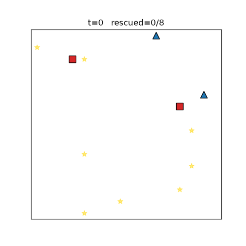
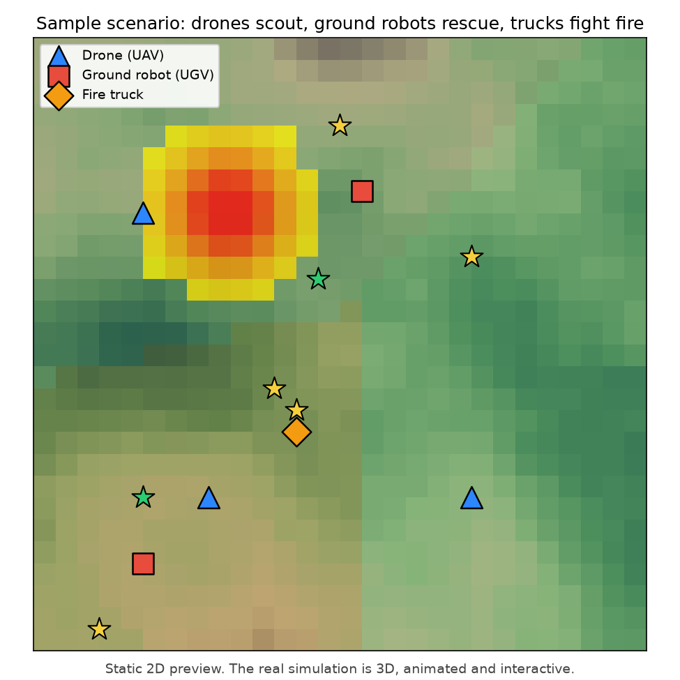
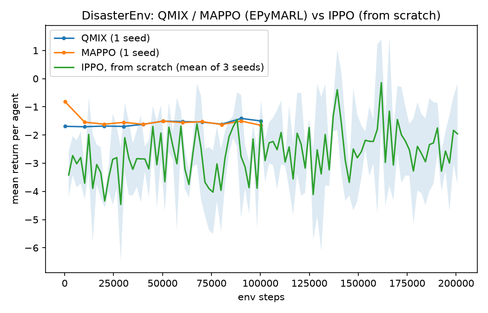
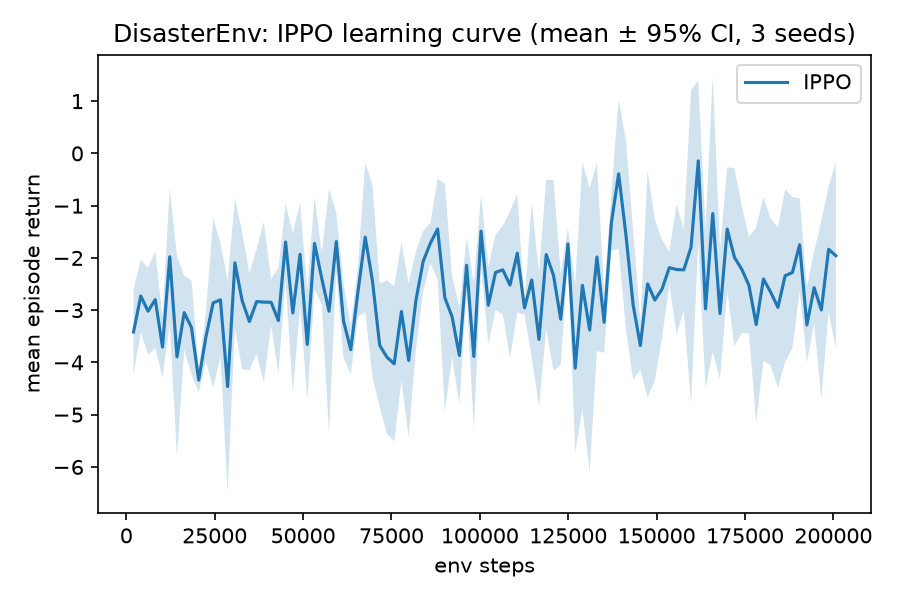

# Cooperative Drone-UGV Disaster Response

Drones scout a disaster zone and hand what they find to ground robots that do the rescue, with a fairness rule that keeps rescues balanced across the robots. It grew out of my 2024 NSF REU research. [Interactive 3D simulation](https://jackpham-rgb.github.io/drone-ugv-disaster-response/web/sim3d_v3.html)



## Goal

Picture a wildfire zone. A few drones fly over looking for people. Ground robots drive in to reach them. Fire trucks keep the fire from spreading. The drones and ground robots never talk directly: drones mark what they find on a shared map, and ground robots plan from that map, like a search team coordinating over radio.

The question: can robots learn to divide this work well, and fairly, from reward alone?

## How it works

In my [REU project](https://github.com/jackpham-rgb/area-disaster-response) every robot did every job. Here the team is split by role.

| Role | Agent | Learning method | Job |
|---|---|---|---|
| Air | Drones (UAV) | MAPPO | Scout, find survivors, map the fire |
| Ground | Rescue robots (UGV) | QMIX | Read the drones' map, drive to survivors, rescue |
| Ground | Fire trucks | Greedy rule | Put out fire near their target |

Some terms I picked up along the way:

- **Multi-agent reinforcement learning (MARL).** Several agents each learn a policy, a rule for what to do in each situation, by trial and reward.
- **The shared map** is called a belief map, because it holds what the team believes, not the full truth. Ground robots only see what drones have uncovered, so the hard part is how information flows, not just how each robot moves.
- **MAPPO** (multi-agent PPO) trains each agent with a stable policy-gradient method, and lets them use the whole team's information while training even though each acts alone afterward. That pattern is called centralized training, decentralized execution.
- **QMIX** learns a score for each robot's possible actions and combines them into a team score in a way that keeps each robot's best choice consistent with the team's best choice.

The fairness reward from the REU work is still here:

$$r_t^i = \frac{\varepsilon + \left|e_t^i / \bar{e}_t - 1\right|}{\bar{e}_t}$$

It is subtracted from each rescue robot's QMIX score, so a robot that has already done more rescues is less eager to claim the next one.

## Results



A static top-down view of one scenario. The [interactive 3D simulation](https://jackpham-rgb.github.io/drone-ugv-disaster-response/web/sim3d_v3.html) shows it animated: drag to orbit the terrain, scroll to zoom, switch policies while it runs.

Training runs on a smaller 16 x 16 grid with 2 drones, 2 ground robots and 8 survivors, because learning needs millions of steps and the full 3D scene is far too slow for that.



| Method | Training | Final return per agent |
|---|---|---|
| QMIX | 100,000 steps, 1 seed, [EPyMARL](https://github.com/uoe-agents/epymarl) | −1.50 |
| MAPPO | 100,000 steps, 1 seed, EPyMARL | −1.655 |
| IPPO, my own implementation | 200,000 steps, 3 seeds | −1.958 |

Return is total reward over an episode; higher is better. A robot that never moves scores about −2 from the time penalty alone, so all three are only a little better than doing nothing. The trained IPPO policy rescues 42.5% ± 6.2% of survivors with a Gini index of 0.259 (0 means perfectly even workload).



## What broke and how I fixed it

- **Two kinds of "return".** EPyMARL adds up all agents' rewards into one team score, while my IPPO reports the average per agent. Plotted raw, QMIX and MAPPO looked worse than IPPO. Dividing by the number of agents put them on the same scale, and the order flipped.
- **MAPPO would not run in parallel on Windows.** EPyMARL collects 10 episodes at once in separate processes, and on Windows each process re-imports the environment in a way my adapter did not survive. I ran MAPPO with one episode at a time instead, which works but means it was trained with less data per update than it normally gets.

## Reproduce it

```bash
pip install -r requirements.txt
python -m scripts.sanity_random    # the environment runs
python -m scripts.train_ippo       # trains IPPO on 3 seeds
python -m scripts.make_plots       # results/learning_curve.png
python -m scripts.render_rollout   # results/demo.gif
```

QMIX and MAPPO run through EPyMARL; the setup steps are in [docs/research_elevation.md](docs/research_elevation.md). The original research notebook is in `notebooks/` and runs alongside `drone_ugv_sim.py`.

## Repo layout

```
src/marl/envs/       training environment (PettingZoo) and the EPyMARL adapter
src/marl/algos/      IPPO
src/marl/coverage/   area splitting, sweep paths, routing and collision-safety modules
src/marl/fairness.py fairness reward, Gini and Jain metrics
scripts/             train, evaluate, plot, render
results/             curves, comparison, demo GIF, map preview
notebooks/           the original research notebook
web/                 the 3D simulation and research pages
```

## Limits and next revision

- One seed each for QMIX and MAPPO, three for IPPO. None of them rescue most survivors yet.
- Results are on my own environment, not a standard benchmark.
- The browser simulation shows the two-role design and the fairness idea; its policies are rules, not the trained networks.
- Next: longer training, more seeds, the fairness term switched on and off to measure what it does, and the coverage modules wired into training.

## Algorithms used

MAPPO: Yu et al. (2021). *The Surprising Effectiveness of PPO in Cooperative Multi-Agent Games.* NeurIPS.

QMIX: Rashid et al. (2018). *QMIX: Monotonic Value Function Factorisation for Deep Multi-Agent RL.* ICML.

Fairness reward: Liu et al. (2022). *A fairness-aware cooperation strategy for multi-agent systems driven by DRL.* CCC.

Boids: Reynolds (1987). *Flocks, herds, and schools: A distributed behavioral model.* SIGGRAPH.

## Acknowledgments

Thanks to Dr. Adam Thorpe and Dr. Ufuk Topcu at UT Austin for the REU mentorship, and to TACC and the NSF for supporting the summer research that started this.

NSF REU Site: CI Research for Social Change, Award #2150390
